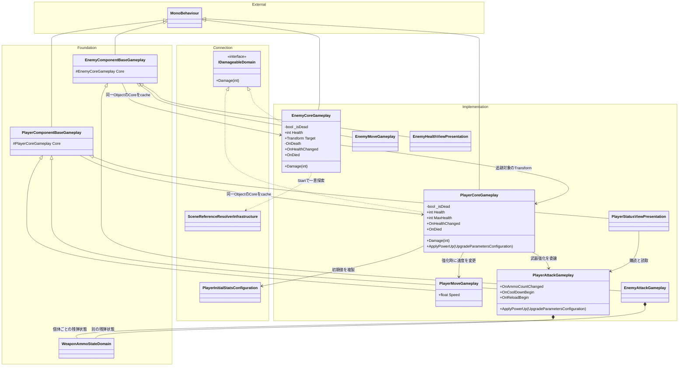
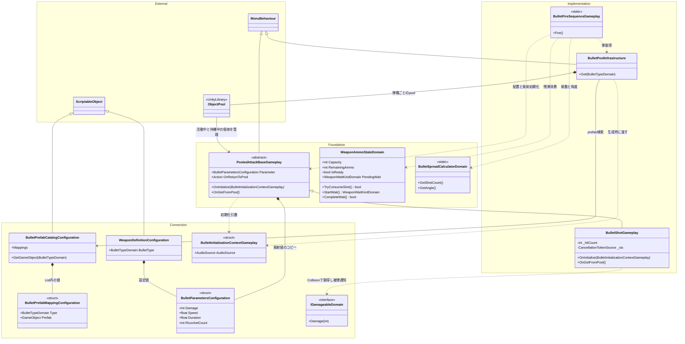
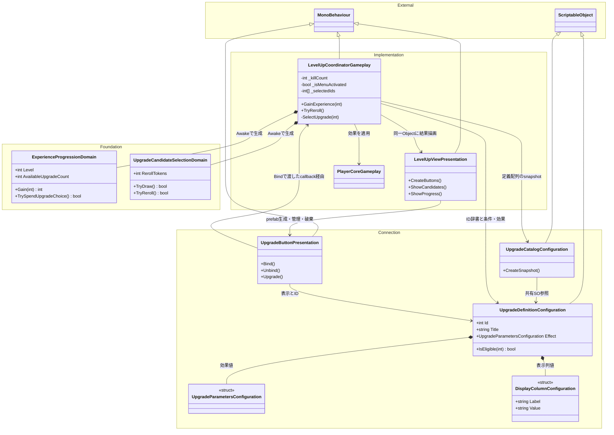

# 機能別のクラス図

タグ: `現行仕様` `クラス設計` `継承` `状態所有` `Mermaid`

確認日/対象版/差分の範囲は[図式の索引](architecture-diagrams.md)。凡例: `基底 <|-- 派生`は継承、`契約 <|.. 実装`はinterface実装、`所有者 *-- 値`は個体ごとに生成/保持するC#状態、`参照元 --> 先`は呼出/読取参照、`..>`はその手順だけの利用。Unityコンポーネント間の参照はUnityによる寿命管理のためcompositionを使わない。SOの参照共有にもcompositionを使わない。全型のファイル/責務は[対応表](architecture-script-catalog.md)。メンバーは関係を説明する主要入口のみ。

## Player/Enemy：体力・移動・攻撃・表示

各図のnamespace囲みは責務の説明用で、実装のC#名前空間ではない。Foundationは規則と自作共通基底、Implementationは制御と具体実装、Connectionは設定と接続契約、ExternalはUnity基底や外部ライブラリを表す。詳細は[配色の凡例](architecture-diagrams.md#責務分類と配色の凡例)を参照。

<!-- diagram-id: architecture-classes-1 -->

[体力・操作クラスSVG](diagrams/classes-actors.svg)。Coreの`_isDead`はAwakeで初期化。死亡Damageは体力通知前に確定し、ローカル`becameDead`だけが副作用を発行する。Health/MaxHealthの変更、通常OnEnableでは解除しない。通常被弾の通知/最大体力強化は維持。[シーケンス](architecture-sequences.md)で敵とプレイヤーの死亡順序を区別する。

## Combat：射撃・弾の生成と返却

<!-- diagram-id: architecture-classes-2 -->

[射撃クラスSVG](diagrams/classes-combat.svg)。Mappingはカタログファイル内の値型、ObjectPoolはUnity外部クラス。弾のRigidbody/Transform/音源はUnity側に所属し図では省略。pool作成時に生成親・音源・初期化・返却delegateを設定する。FireはGet（非活動）→値と配置→有効化→OnGetFromPoolの順。GoF Template MethodやAbstract Factoryとは断定しない。

## Progression：状態・定義・表示・選択

<!-- diagram-id: architecture-classes-3 -->

[進行クラスSVG](diagrams/classes-progression.svg)。候補ID/メニュー/撃破数はCoordinator、経験値/残選択回数はProgression、再抽選トークンはSelection、表示部品はViewが管理する。定義SOの配列とID辞書は参照のコピー。表示列値型はUpgradeDefinitionファイル内の入れ子型。[定義/UI仕様](upgrade-catalog-and-ui.md)に条件と追加手順がある。
