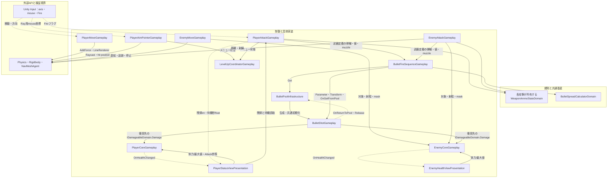
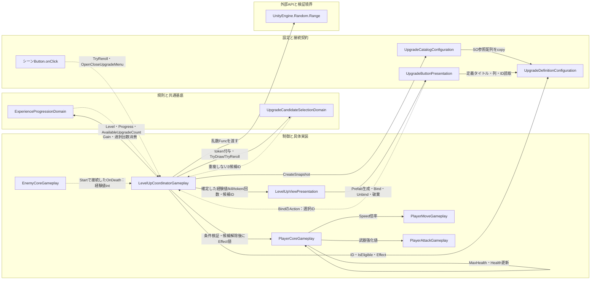

# スクリプト依存・イベントとデータ授受

タグ: `現行仕様` `相関図` `イベント購読` `データフロー` `Mermaid`

対象版と範囲は[索引](architecture-diagrams.md)。実線`-->`は呼出元/読取元→依存先、点線`-.->`は発生元→通知先のデータ/イベント。ラベルを優先し、点線をコンパイル依存の方向として読まない。実コードは[対応表](architecture-script-catalog.md)参照。

## 操作・射撃・移動・表示

<!-- diagram-id: architecture-correlations-1 -->

[操作相関SVG](diagrams/correlation-combat.svg)。PlayerUIはPCからHealth/MaxHealthとAttack参照を取得し、残弾/待機はPAから読む。移動はInput軸＋Transform、照準Pointerはレイヒット位置を更新し、PlayerMoveの`_lookAt`がある場合にその位置へ向く。配線による参照は[必須参照](component-dependencies.md)を参照する。

## 報酬・強化定義・候補・動的UI

<!-- diagram-id: architecture-correlations-2 -->

[進行相関SVG](diagrams/correlation-progression.svg)。通常の動的ボタンは`SelectUpgrade`を通る。公開の旧`ApplyPowerUp`入口は選択回数検証を内包せず、図の通常経路と同一視しない。Viewは進行のイベントを購読せずCoordinatorからShow*を呼ばれる。DOTween完了を経験値確定の条件にしない。

## 購読と参照の寿命

| 接続 | 登録/取得 | 解除/終端 | データと注意 |
| --- | --- | --- | --- |
| PlayerUI→Core/Attack | Startで参照/初期化しOnEnableを実行。以後OnEnableで購読と現在値の復元 | OnDisableで全4通知を解除、待機TweenをKill | 体力通知は引数なし、残弾int、2待機通知float。初回OnEnableは初期化前なら購読しない |
| EnemyUI→EnemyCore | Start初期化後と以後OnEnableで購読 | OnDisable解除 | Health通知後Coreの現在値を読む |
| EnemyCore→Coordinator | Startで同一シーン一意探索、private OnDeathにGainExperience登録 | 通常OnDisableで解除/再登録しない。敵個体の寿命に結び付く | 再有効化による二重登録を行わない。死亡はAwake以外で解除しない |
| Button→Coordinator | View.CreateButtonsでBind、Actionが管理側SelectUpgradeを捕捉 | 再生成時Unbind→inactive→親分離→Destroy | 古いUIからの選択を防ぐ。PrefabのonClickはUpgradeを呼ぶ |
| Bullet→Pool | factory callbackで返却Actionを注入、閉包がpoolを捕捉 | 弾のDestroyで個体寿命終了 | Releaseはinactiveにする。activeSelfチェックで重複返却を防ぐ |
| Attack/Bullet非同期 | OnEnable/発射でCTSを生成、UniTask.DelayにTokenを渡す | OnDisable Cancel/Dispose（弾はnullへ） | Attack再有効化は未完了待機を初めから再開始、弾は発射ごとに寿命を設定 |
| Camera/Scene参照 | StartやAwakeで取得/Inspector指定 | Unityのscene/Object寿命 | RequireUniqueは同一シーンの活動中Objectだけを探索、Sceneロード時の永続serviceは持たない |

両Coreのpublic Actionフィールドは`event`キーワードではない。UnityEvent.OnDiedの購読者はInspectorまたは外部登録で決まり、特定のゲーム終了機能を実装済みとして仮定しない。
