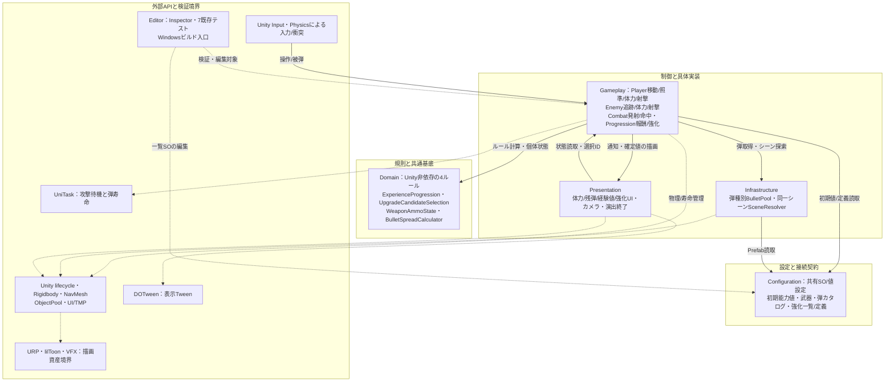
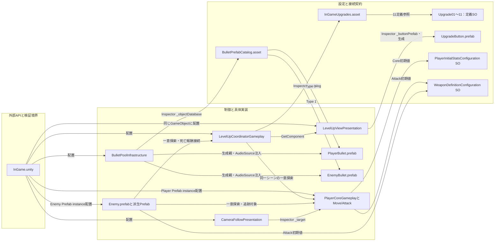

# 現行クラス設計・パターン・スクリプト相関図

タグ: `現行仕様` `クラス設計` `Mermaid` `依存関係` `設計パターン` `再開情報`

- 確認日: 2026-10-11。対象コードHEAD: `e87e95adc3de00abba3ce10599032ec9e722c277`（R-01死亡処理完了版）。この文書を追加するコミットでもランタイムコードは同版。
- 対象: 自作ランタイムC# 36ファイル、InGameシーン、関連Prefab・ScriptableObject（SO）。Editorの7既存テストクラスと強化一覧Inspectorは境界として扱う。
- 作業ツリー差分: stagedのVFXシェーダーとmeta、3 URP設定、ProjectSettings、既存仕様・検証文書2件、untrackedのVfxShaderRenderingTestsとmetaを確認。ランタイムC#の未コミット変更はない。未完了V-02は描画設定/Editor検証の境界注記にのみ反映し、設計や検証済み範囲へ混入させない。
- 原本: この文書と下記3文書のMermaidコードブロック。役割配色は説明JSONのpresentation.rolesをビューアが適用する。既存SVGは2026-10-11時点の閲覧資料として保持し、今回の囲み・配色更新は反映しない。既存の[機能責務・拡張箇所](gameplay-architecture.md)は状態所有者と拡張手順の正本、ここは図の正本。

## 責務分類と配色の凡例

2026-10-12、共通CLI 1.1.0で全11図の125 leafノードへ役割を設定した。対象文書HEADは`c90020c55d42df9c3d4cae71abee223d75e6b2cd`、ランタイムコードは上記R-01版と同じ。既存V-02差分は保持した。

| roles値 | 責務と囲み | 分類の例 |
| --- | --- | --- |
| foundation | 規則と共通基底（Foundation、暗い紫） | 純粋C#の進行・残弾・拡散ルール、自作のCore参照基底、弾の抽象基底 |
| middle | 制御と具体実装（Implementation、中間の紫） | Core、移動・攻撃、Pool、進行管理、状態表示 |
| surface | 設定と接続契約（Connection、明るい紫） | 被弾interface、共有設定と値型、選択IDの通知、同一シーンの参照取得 |
| external | 外部APIと検証境界（External、中立色） | Unity基底/API、シーン配置、外部ライブラリ、Editor検証、操作主体 |

囲みは責務を読み分ける説明用の分類で、asmdefや実装の名前空間、状態・寿命の共有単位を新設するものではない。シーケンス図では参加者の役割だけを設定し、既存の処理順・分岐・並行区分を保持する。色コードはハブのビューア管理とし、原本へ直接埋め込まない。[更新手順](architecture-document-workflow.md)と[検証証拠](../tasks/architecture-presentation-verification.md)を参照。

| 読む順 | 提出物 | 内容 |
| --- | --- | --- |
| 1 | 本文 | 全体構成、実シーン配線、パターンと成立範囲 |
| 2 | [クラス図](architecture-classes.md) | Player/Enemy、射撃プール、進行と設定の継承・契約・所有・参照 |
| 3 | [相関図](architecture-correlations.md) | 呼び出し、データ授受、購読/解除、入力・物理・表示の関係 |
| 4 | [シーケンス図](architecture-sequences.md) | 起動、射撃、死亡と再入、強化選択 |
| 5 | [全スクリプト対応表](architecture-script-catalog.md) | 36ランタイムファイルの役割・基底/契約・依存・実ファイル参照、Editor境界 |

## 全体構成

矢印は実行時の呼出元/読取元から依存先。点線は外部API利用または検証対象。箱は責務の区分で、asmdefによる強制分離はない。概要では機能を集約し、具体的なクラス間経路は機能別の相関図に分ける。PresentationからGameplayへの状態読取と、GameplayからPresentationへの結果通知の両方向がある。

<!-- diagram-id: architecture-diagrams-1 -->

[全体構成SVG](diagrams/overview.svg)。Domain末尾でも`BulletTypeDomain`/`WeaponWaitKindDomain`は列挙、`IDamageableDomain`は契約であり、4ルールとは区別する。値型の`BulletParametersConfiguration`はUnity属性/Mathfを使うため純粋C#ではない。UniTaskは攻撃/弾、DOTweenは表示の直接依存。URP/lilToonは描画資産の依存で自作ゲームコードから直接呼んでいない。Cinemachine等の導入済みパッケージを、利用根拠のない設計要素として加えない。

## シーン・Prefab・SOの配線

矢印は参照を持つ側→参照先。ラベルはInspector設定、同一オブジェクト取得、シーン探索、生成を区別する。UnityがGameObject/Componentの寿命を管理し、SO参照の共有は個体状態の共有を意味しない。

<!-- diagram-id: architecture-diagrams-2 -->

[配線SVG](diagrams/wiring.svg)。根拠は[InGame](../../Assets/Scenes/InGame.unity)、[弾カタログ](../../Assets/GameData/Combat/BulletPrefabCatalog.asset)、[強化一覧](../../Assets/GameData/Progression/InGameUpgrades.asset)、[PlayerBullet](../../Assets/Prefab/PlayerBullet.prefab)、[EnemyBullet](../../Assets/Prefab/EnemyBullet.prefab)、[UpgradeButton](../../Assets/Prefab/UpgradeButton.prefab)。Scene内のCoordinator/ViewはGameObject fileID `232733428`、Poolは`1593498834`。View/PoolのAudioSource参照はともに`1673618211`。Player/EnemyはPrefabのコンポーネント配線とシーン配置を併用する。具体的な必須参照と取得タイミングは[参照一覧](component-dependencies.md)。SOの一覧スナップショットは配列のコピーで、定義SO自体のdeep copyではない。

## 設計パターンの対応と成立範囲

| 方式 | 実クラス/根拠入口 | 目的 | 成立範囲・限界 |
| --- | --- | --- | --- |
| 軽量なレイヤード設計 | 4 Domainルール、Gameplay、Presentation、Configuration、Infrastructure。[対応表](architecture-script-catalog.md) | ルールをUnity処理/表示から分けて直接テスト | 論理区分。asmdefで隔離したClean Architectureではない。Core/敵行動/命中にUnity依存ルールが残る |
| Observer相当の同期通知 | Core.OnHealthChanged、PlayerAttackの残弾/待機通知、両UIのOnEnable/OnDisable | 状態確定と描画を分離、無効UIの購読を解除 | C# Actionフィールド/UnityEvent。メッセージバスではなく、購読者の同期再入も起きる。進行Viewは直接呼出しで更新 |
| Object Pool | BulletPoolInfrastructure.Start/Get、Unity ObjectPool、PooledAttackBaseGameplay.OnReturnToPool | 種類別に生成/再利用して寿命終了時返却 | 弾のみ。敵/プレイヤー復活プールではない。Get時点で有効化され、配置前OnEnableが起きる。全プールをOnDestroyでClearする仕組みはない |
| カタログによる生成先選択・factory callback | BulletPrefabCatalogConfiguration.GetGameObjectとPoolのcreateFunc | enumからPrefabを選び、生成時初期化/音注入を集中 | GoF Abstract Factoryの製品群やFactory Methodの生成者継承はない |
| 外部設定によるデータ駆動 | 初期能力値/武器/強化SO、UpgradeCatalog.CreateSnapshot、View.CreateButtons | 共通設定と個体状態を分離、強化項目からUIを生成 | SOに取得済み状態を書かない。強化の計算手順はCore/Attackに残る。SOをFlyweightパターンとして断定しない |
| 手動の依存注入（一部） | Inspector参照、BulletShot.SetAudioSource、Selection.TryDrawの乱数Func、UpgradeButton.BindのAction | 取得元を明示、共有音源と乱数/選択経路を交換可能にする | DIコンテナなし。GetComponent/RequireUniqueで自己取得する依存も多い。乱数関数はStrategy相当の交換点だけで、戦略クラス階層はない |
| Presenterに近い表示分離（一部） | Coordinator→LevelUpView.Show*、Core/Attack→StatusView | 確定状態の描画とボタンの意図を分離 | Coordinatorはゲーム進行も担当、View interfaceなし。厳密なMVP/MVC全体構成として断定しない |
| 契約とポリモーフィズム | IDamageableDomain.Damage、PooledAttackBaseGameplay抽象フック | 衝突側をEnemy/Player具体型から切り離し、弾に共通フック | IDamageableはinterface実装。抽象フックだけでありTemplate Methodの基底アルゴリズムではない |
| 明示状態＋取消トークン | WeaponAmmoStateDomain.PendingWait、Attack/BulletShotのCTS | 残弾/待機を確定し、無効化で非同期待機を終了 | enum/フラグ方式。GoF Stateの状態オブジェクトではない。死亡フラグはAwakeだけで解除、復活機能なし |
| 同一シーン一意参照のresolver（独自方式） | SceneReferenceResolverInfrastructure.RequireUnique | 参照不備/重複を早期に診断 | FindObjectsByTypeで活動中の同一シーンを探索する静的ヘルパー。Singleton、永続global service、DI registryではない |
| 機能別コンポーネント合成 | PlayerCore/Move/Attack、EnemyCore/Move/Attack、各ComponentBase | 体力/操作/表示を同一GameObjectの部品へ分割 | Unityコンポーネント方式。ComponentBaseはCore取得共通化、ECSや敵行動Stateではない |

根拠入口は全て[スクリプト対応表](architecture-script-catalog.md)から実装へ辿れる。改修候補A-10全面共通化・A-11〜A-13やR-02の有効化順変更は現行設計に描き込まない。

## 確認結果と再開情報

今回の確認はコード、GUID/fileID配線、継承/契約、イベント登録・解除、文書リンク、および11図のMermaid解析・SVG生成と閲覧確認。生成環境と原本対応は[SVG索引](diagrams/README.md)。ゲーム動作/描画比較の再検証は実施しない。R-01の61テスト成功とWindows Developmentビルドの証拠は[死亡処理検証](../tasks/death-once-verification.md)。未コミットV-02の描画比較は[既存検証記録](../tasks/headless-verification.md)の未完了条件を維持する。

再開時はこの文書の対象コードHEADと現在の`Assets/Scripts`差分を比較する。コードの継承/参照/通知やシーン配線が変わった機能の図、対応表、architecture-descriptions.jsonを同じ変更単位で更新する。旧全体呼出図は重複を避け本書の相関図へ統合する。原本は固定図ID付きMermaidブロックと説明JSONである。現在の更新は[共通CLI手順](architecture-document-workflow.md)のdoctor→sync→inventory→apply→validateを使い、過去のSVGを再生成する手順とは区別する。
