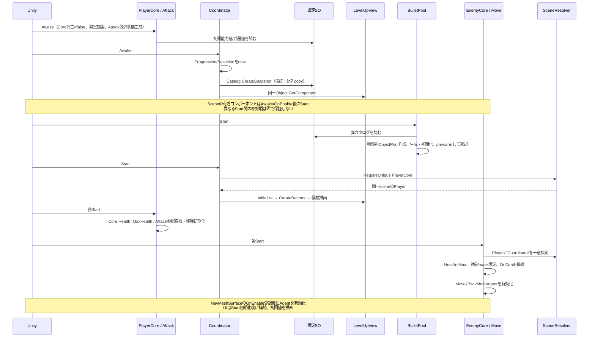
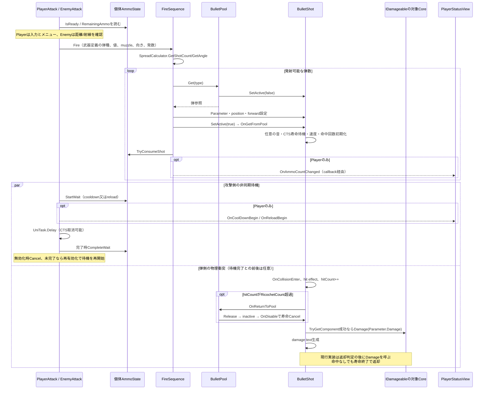
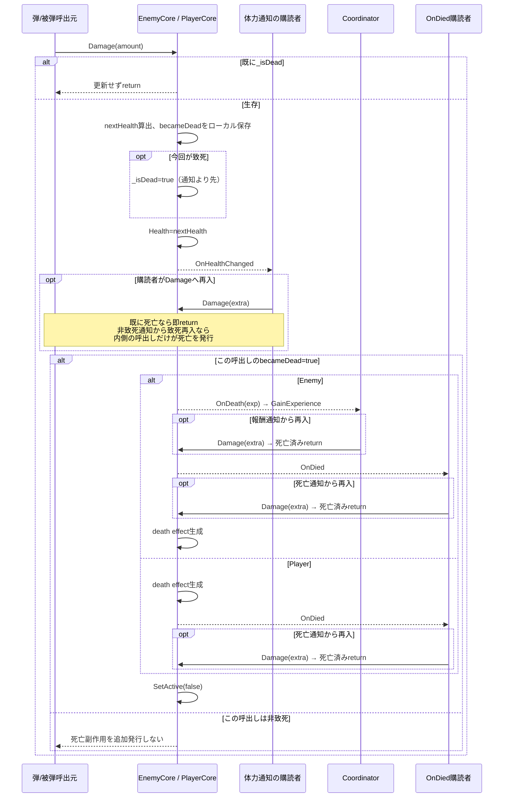
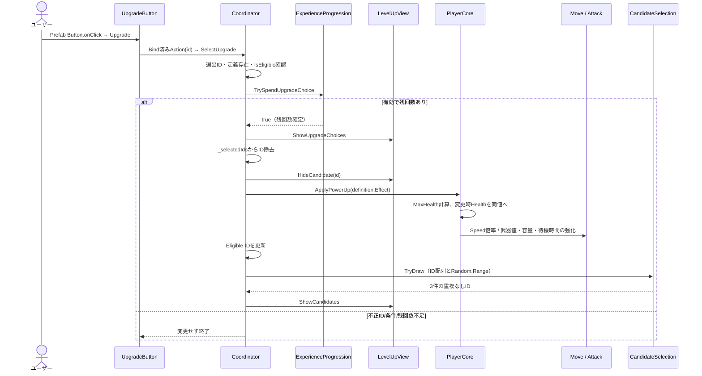

# 起動・射撃・死亡・強化のシーケンス

タグ: `現行仕様` `シーケンス` `初期化` `死亡再入` `Mermaid`

対象版は[索引](architecture-diagrams.md)。`->>`は同期呼出、`-->>`は返値/通知、`Note`は条件と寿命、`alt/opt/loop`は分岐/繰返し。異なるコンポーネントのStart順序を全順序として保証しない。図のStart処理は各コンポーネント内の順序を列挙したもの。コード入口は[対応表](architecture-script-catalog.md)。

## 起動：状態生成と配線

<!-- diagram-id: architecture-sequences-1 -->

[起動SVG](diagrams/sequence-startup.svg)。SOは読取元で初期値を個体へ複製。SceneResolverの成功は同一シーンで必要コンポーネントが一意かつ活動中であることが条件。非活動Objectや未設定参照は診断対象。

## 射撃・命中・返却

<!-- diagram-id: architecture-sequences-2 -->

[射撃SVG](diagrams/sequence-fire.svg)。待機種類を確定してUIへ通知した後、Delayをawaitする。プールの有効化が配置より先である現状を変更案に置き換えない。

## 死亡：通知中の再入を含む一度きり保証

<!-- diagram-id: architecture-sequences-3 -->

[死亡SVG](diagrams/sequence-death.svg)。敵の報酬通知からの再入も死亡済みreturnになる。通知からの再入は各通知の同期呼出スタック内で起きる。Health setter自体は死亡判定しない。復活/敵再利用のresetは未実装で、Awake以外で死亡を解除しない。必須effect不備などの例外に対するトランザクション/再試行保証ではない。[R-01証拠](../tasks/death-once-verification.md)参照。

## 強化選択：定義IDから個体値へ

<!-- diagram-id: architecture-sequences-4 -->

[強化SVG](diagrams/sequence-upgrade.svg)。候補解除は効果適用前なので、能力変更通知中に同一候補から再入しても二重適用しない。通常選択後の抽選はtoken不要、シーンTryReroll操作はtoken3消費を伴う別経路。ボタン生成/列配置はView/UpgradeButton、候補判定と能力計算はゲーム側。
